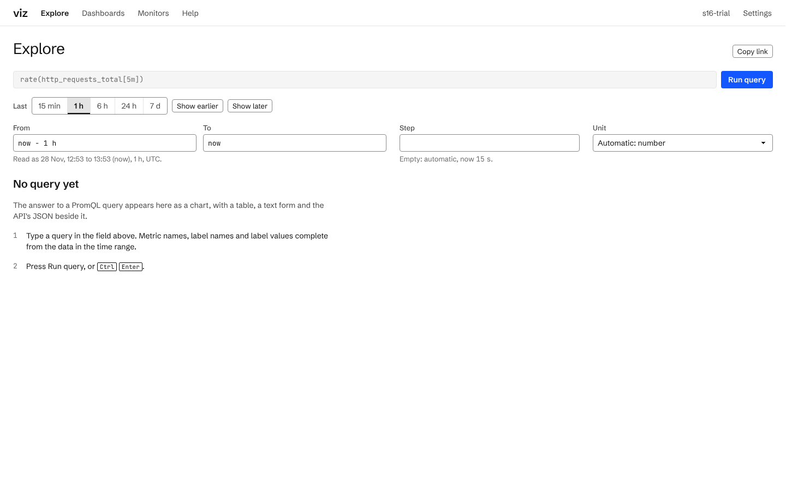
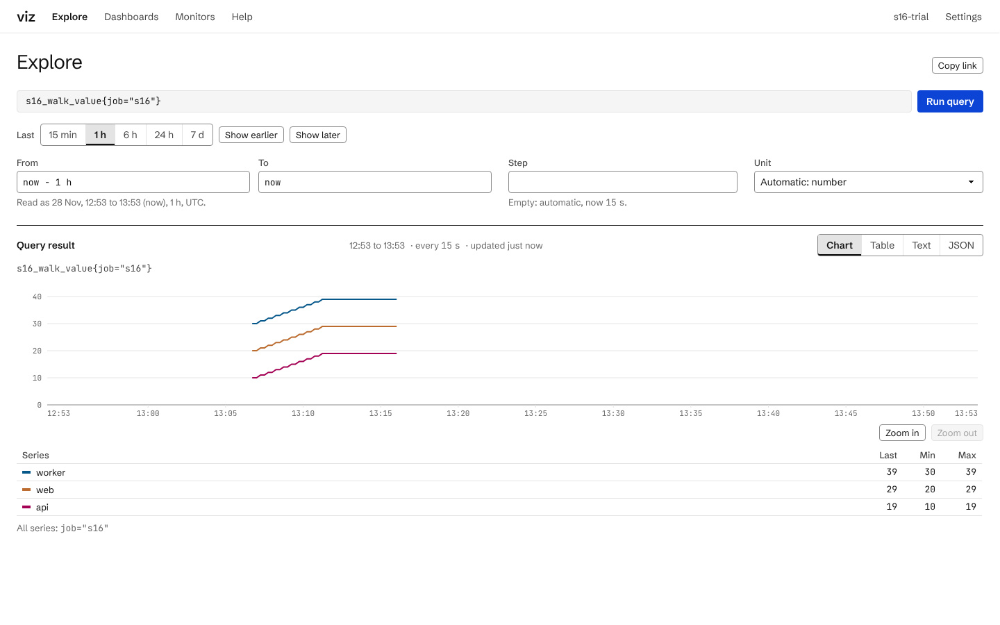
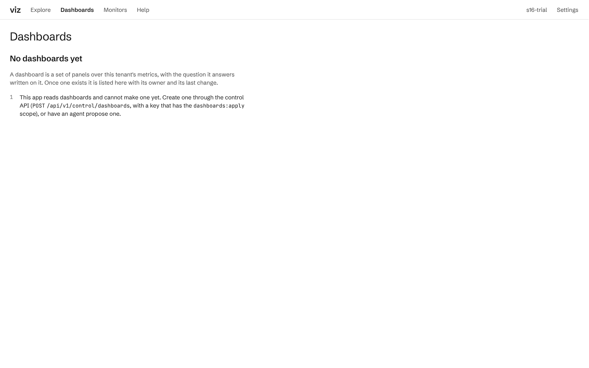
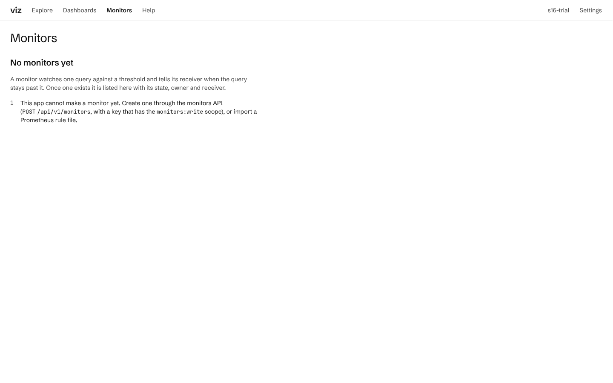

# S16: the web app on a stage, before its first production release (D74)

**Status (2026-11-28): done; the stage is destroyed. Checks 6, 7, 9 and 10 passed, and so did
1 to 5 (the smoke test). Check 8 is half made: the rollback to a version without the app could not be
made, because the release without the app was refused in this session. So the evidence entry is not
yet complete ("What the evidence says").** The owner authorised stage deploys on 2026-11-28 (standing,
recorded in `AGENTS.md`, "The Cloudflare account"). Numbers are measured on Cloudflare from outside
(this sandbox, through its proxy) unless said otherwise.

This is the stage that `deploy/README.md`, "A stage before production", asks to go before the first
production release that carries the web app: `release.mjs` refuses that release unless
`deploy/records/app-stage-evidence.json` holds a complete entry for its serving fingerprint. The smoke
test checks items 1 to 5 of "What a first deploy to a stage should check"; items 6 to 10 are made here by
hand and recorded in the entry and below.

## What will be deployed

Stage `s16`, from branch `claude/cloudflare-observability-platform-ibaqya-ui` (2846fb8; `engine/` unchanged
from main, so the prebuilt engines of main are used, `VIZ_WASM_PREBUILT=1`, no Rust build). Names
`viz-s16-*` only, reached on workers.dev only (`https://viz-s16-gateway.<account-subdomain>.workers.dev`):

- Workers `viz-s16-publisher`, `-ingest`, `-control`, `-query`, `-ruler`, `-mcp`, `-gateway` (only the
  gateway on workers.dev; it carries the web app's static assets);
- R2 `viz-s16-lake`, KV `viz-s16-config`, queues `viz-s16-flush`, `-maint`, `-flush-dlq`, `-maint-dlq`,
  and the stage's rate-limit ids, all made by `deploy/resources.mjs ensure --stage s16`.

Production (`viz-gateway` and the rest, `viz-lake`, `viz-config`, `viz.bitcru.sh`, `vis.bitcru.sh`),
`viz-preview-app` and every resource not named `viz-s16-*` are never touched. No DNS, route or custom
domain is created.

The web app is built the way `deploy.sh` builds it by hand for a stage: `app.mjs handover` in an export of
its sources outside the checkout, started with every credential removed from its environment by name,
then taken as data by `app.mjs build --from` (`deploy/README.md`, "Who can read the Cloudflare token":
the weaker of the two arrangements, accepted for a stage).

**Releases planned** (each `deploy/deploy.sh --stage s16`, with `VIZ_STAGE_EXPIRES_AT`):

| # | Release | Why |
|---|---|---|
| R0 (not run: refused, see "What ran") | without the app (`VIZ_WITHOUT_APP=1`) | a version from before the app, for check 8's rollback (the stage is new, so none exists otherwise) |
| R1 | the branch as it is, with the app | the stage under test; smoke with `SMOKE_KEY`; checks 6, 9, 10 |
| R2 | the branch with one lazily loaded module's text changed in the worktree (never committed) | check 7: a release that changes a chunk |
| — | `release.mjs rollback --only viz-gateway` to R1, then to R0 | check 8 |
| R3 | the branch as it is again, with the app | check 8's last part (the next release's `carry`); the release the evidence entry is written from; the browser walk-through |

**Worst-case cost, stated before anything runs** (modelled, Workers Paid list rates):
- at most 4 hours: `VIZ_STAGE_EXPIRES_AT` stops the ruler's alarms and cron by themselves; the stage is
  destroyed as soon as the checks are made;
- four releases and two rollbacks;
- requests: a few hundred page loads (check 6 and the browser walk; the asset requests among them are free
  if check 6 holds, about 10 Worker requests per load if it does not), about 100 Remote Write and query
  requests, the smoke tests (a few hundred requests each);
- Durable Object requests in the low thousands, KV writes under 100, R2 operations under 1,000, queue
  messages under 1,000.

Under US$0.05 modelled; **stated as under US$1 worst case**. Usage is to be read from the analytics API
afterwards (`spikes/s10-signals-trial/analytics.mjs`, with the stage's ids recorded before it is destroyed).

**Expiry and deletion.** `VIZ_STAGE_EXPIRES_AT` = 2026-11-28T16:45:00Z (under 4 hours after the first
deploy). Deleted with `node deploy/resources.mjs destroy --stage s16` when the checks are done, and the
account inventory (`spikes/s11-large-ledger/inventory.mjs`) taken again and diffed with the one before:
only `viz-s16-*` names may have come and gone.

## Inventory before (2026-11-28T12:45:22Z, read only)

29 Workers (viz: the seven of production, `viz-preview-app`, `viz-spike-s12-reload`), 7 R2 buckets
(`viz-lake`), 8 KV namespaces (`viz-config`), 4 queues (production's), 28 Durable Object namespaces,
14 custom domains (`viz.bitcru.sh` and `vis.bitcru.sh` → `viz-gateway`). No `viz-s16-` name.

## Results

### What ran (2026-11-28, UTC)

R0, the release without the app, **did not run**: this session's permission check refused it (the
request for this stage said that a stage may not go without the app), and it was not attempted again.
So the stage never had a gateway version without the app, and the second half of check 8 could not be
made (below). Everything else ran in the planned order.

| Step | Result |
|---|---|
| R1 `s16-r1`, `deploy.sh --stage s16` (prebuilt engines, app built here by `app.mjs handover` with the credentials removed, then `app.mjs build --from`) | exit 0 in 112 s (12:46 to 12:48); seven Workers created; `OAUTH_CLIENT_KEY` created on `viz-s16-control`; web app build `55295e17ba2d`, 8 files; smoke passed with the app checked (24 requests, every file's bytes as staged) |
| `bootstrap.mjs --tenant s16-trial --stage s16 --key-file … --smoke-key-file …` | admin and smoke keys written to 0600 files in the session's scratch directory; nothing printed; `VIZ_BOOTSTRAP` deleted again |
| smoke again with `SMOKE_KEY` (from its file) | passed: healthy, the app (24 requests), Remote Write 204 in 438 ms, all 9 samples read 784 ms after the acknowledgement |
| R2 `s16-r2`: the worktree with one string of `app/src/monitors/MonitorsPage.tsx` changed (never committed; restored right after) | exit 0 in 131 s (it first waited for the machine lock); build `04ca949842fc`; "3 of 3 files kept"; smoke passed (27 requests, the kept files included) |
| `release.mjs rollback --stage s16 --record release-s16-r1.json --only viz-s16-gateway` | exit 0; "viz-s16-gateway goes back to web app build 55295e17ba2d (it serves 04ca949842fc now)" |
| R3 `s16-r3`: the branch as committed, `SMOKE_KEY` in the deploy's environment | exit 0 in 148 s; build `55295e17ba2d` again, 0 kept (`carry`: serving build the same, wanted 0); `OAUTH_CLIENT_KEY` kept; smoke passed with the app (24 requests) and the data (Remote Write 204 in 338 ms, 9 samples 244 ms after) |
| `scripts/app-stage-evidence.mjs --stage s16 --by "Claude (stage run, 2026-11-28)"` | entry of release `s16-r3`, serving fingerprint `90565874546a75b90dedb05457525cc82faaec6e94765fa280dd3d8c9d228f05` (the same in R1, R2 and R3's records) |

The serving fingerprint is this branch's at 2846fb8: R1 and R3 were built from the clean worktree, and R2's
one change was in `app/src`, which the fingerprint does not cover.

### The checks of "What a first deploy to a stage should check"

Items 1 to 5 are the smoke test's, passed on every release above. Items 6 to 10, by hand:

| # | Result | What was seen |
|---|---|---|
| 6 | **pass** | R1, 12:50:36 to 12:50:44: 20 page loads, each `GET /` and `GET` of all 8 files of the build (20 documents, 160 files, all 200). Analytics API, 12:50:30 to 12:50:50: `workersInvocationsAdaptive` for `viz-s16-gateway`, **20** requests (fetch, success); `workersAssetsRequestsAdaptiveGroups` for the gateway's hostname, **160** requests (200, cache status HIT). The files are not Worker requests: D74's cost is now measured on Cloudflare for this window, not modelled. The first read, about two minutes after the loads, showed 92 asset requests; a read a few minutes later showed all 160. Also seen: the smoke test's `POST` to an asset counts as an asset request with status 405, not as a Worker request |
| 7 | **pass** | R2 changed `MonitorsPage`, and with it `index-….js` and `PromqlEditor-….js`. Its record lists under `kept`, age 1, R1's `/assets/index-dLTlkQ5n.js`, `/assets/MonitorsPage-CcInk74W.js` and `/assets/PromqlEditor-DiMmR-g6.js`, and drops none. From R2, each answered 200 with its recorded SHA-256, `immutable` and `text/javascript`; R2's document names its own `index-D8Xa2Du2.js` |
| 8 | **half made, not marked pass** | Rollback of the gateway alone to R1: R1's document again (ETag `"bece61da78b441648ef5837f091e58d3"`, naming `index-dLTlkQ5n.js`), R1's three chunks 200 with their bytes, R2's `index-D8Xa2Du2.js` and `MonitorsPage-DZMHCAGT.js` the JSON 404, `no-store`. R3 afterwards recorded `carry` with the serving build equal to its own and nothing wanted. **Not made**: the rollback to a version from before the app, and the next release's `carry` after it. No such version exists on this stage, because R0 was refused (above) |
| 9 | **pass** | R1, 44 raw paths with `curl --path-as-is`. Every answer was one of these. The JSON 404 from the Worker (`/assets/../index.html`, `..%2f`, `..%2F`, `%5c`, another case, `%252e%252e`, `/assets/`, `/favicon.svg/`, `/..;/`, `/_headers`, `/assets/../_headers`, `/explore/`, `/%65xplore`, `/index.html`, …). A file of the build, checked by SHA-256 (`/assets/%2e%2e/assets/<f>`, `/assets/./<f>`, `/assets/%2e/<f>`, `/assets/x/../<f>`). A 307 to a file of the build (`/assets//<f>` and `/assets/<name>%2ejs` with the `immutable` header, as the README says; `//assets/<f>` with no `Cache-Control`). The API's 401 (`/assets/../api/v1/query`). The document with its policy, only where the URL parser makes the path a document path (`/..`, `/./`, `/%2e/`, `/assets/..`, `/favicon.svg/..`, `/explore/..`, `/api/v1/%2e%2e/%2e%2e/explore`, `/assets/../dashboards`; review of D74, n-2). Cloudflare's edge 400 (HTML, `cf-ray: -`, before any routing) for paths that climb above the root, and for `%00`. Requests went through this sandbox's egress proxy, which re-terminates TLS; the 307s for encoded forms show that the encoded paths reached Cloudflare |
| 10 | **pass** | R1, with `Accept-Encoding: gzip, deflate, br`: two assets, the icon, `/` and `/explore` came back brotli with a **weak** tag (`W/"…"`). `If-None-Match` with the weak tag got 304 for each, with the strong tag in the 304. An asset's 304 carries `Content-Type`, `Cache-Control: public, max-age=31536000, immutable` (the icon: `max-age=86400`), `ETag` and `nosniff`. The document's 304, from the Worker (`x-viz-route: app`), carries `Content-Type`, `no-cache`, `ETag`, the whole `Content-Security-Policy`, `Cross-Origin-Opener-Policy`, `Referrer-Policy`, `nosniff` and `X-Frame-Options`. Without compression: strong tags, and the same 304s |

**What the evidence says.** `deploy/records/app-stage-evidence.json` holds the entry, with 6, 7, 9 and 10
`pass` and 8 left without a result and a note saying what was and was not made. `release.mjs`'s
`evidenceGaps` names exactly that gap: `by-hand check 8 (result "pass" and a note of what was seen)`. So
**the entry does not yet allow the first production release with the app**. It would, once one of these happens:
the owner allows a release without the app on a stage (R0, then the steps above again: about 15 minutes
on a fresh stage of the same fingerprint), or accepts check 8 as made here, or gives the override
(`VIZ_APP_WITHOUT_STAGE_EVIDENCE`).

### Browser walk-through (R3)

Chromium (Playwright, headless), 1440 × 900, deviceScaleFactor 1, light scheme, at the stage gateway's
workers.dev address. The key was read from its 0600 file and typed into the sign-in form's password
field (never in an address). Three series `s16_walk_value{job="s16", service=api|web|worker}` had been
written by Remote Write first (204; read back 19, 29, 39).

| Run | Key | What happened |
|---|---|---|
| 1 and 2 (13:28, 13:45) | the stage's **admin** key, as planned | **Refused by the app, by design**: "This key is valid for s16-trial but cannot read metrics: it has the admin scope, and Explore needs read. Use a key with the read scope." (Run 1's script waited for the form to go and timed out; run 2 read the message.) |
| 3 (13:51) | `smoke` (write, read) | signed in; Explore ran the query and drew the three series; the dashboards and monitors lists each said "This key cannot read dashboards" (and monitors): `GET /api/v1/control/dashboards` and `GET /api/v1/monitors` answered 403, as they should for that key |
| 4 (13:53) | `viewer`, made with the admin key through `POST /api/v1/control/keys` with `read`, `dashboards:read`, `monitors:read` | signed in in 1.3 s; Explore ran the query and drew the three series; the dashboards list ("No dashboards yet") and the monitors list ("No monitors yet") loaded |

In every run: **no CSP violation** (a `securitypolicyviolation` listener installed before the page's
scripts), **no page error**, no failed request. The one console error in run 4 is Chromium's log of
`401 GET /api/v1/control/whoami`, the app's question on first load with no key in the tab, which is
how it learns to show the sign-in form. The address never held the key; what the tab stored was
`viz.key`, `viz.identity`, `viz.scroll`, `vz-series8:explore` and `viz.chart.reserve:explore`.

**Finding S16-1 (minor, the app with the deploy tooling): the key `bootstrap.mjs` prints cannot sign in
to the web app.** The first key of a tenant has the `admin` scope only, and the app accepts only a key
with `read` (`app/src/shell/session.tsx`). It says so plainly, so nothing is broken, but a person
following the deploy README from bootstrap to the app has to mint a second key through the API first.
Either the app could accept `admin` for reading (control's dashboards list already does), or bootstrap
could make a viewing key too, or the deploy README could say this step. Not changed here.

## Cleanup (13:53 to 13:56 UTC)

- `node deploy/resources.mjs destroy --stage s16` at 13:53:49: the four queue consumers, the seven
  Workers, the four queues, KV `viz-s16-config`, R2 `viz-s16-lake` (37 objects) deleted, the six rate-limit
  ids freed; its leftover check lists nothing. `deploy/resources.json`, which `ensure` had filled with the
  stage's ids, is back to its committed contents.
- Inventory after (13:54:14Z), diffed with the one before (`inventory.mjs --diff`): **no change in any
  category** (29 Workers, 7 buckets, 8 KV namespaces, 4 queues, 28 Durable Object namespaces, 14 custom
  domains, before and after). No `viz-s16-` name remains, and nothing else in the account came or went
  during the run.
- The stage's keys (admin, smoke, viewer) were shredded. The worktree's `node_modules` from `npm ci` and
  the copied engines are git-ignored and removed afterwards.

**Cost** (analytics API, 12:45 to 13:56 UTC, measured on Cloudflare):
- Worker invocations: 1,037 (fetch 1,002, cron 5, queue 30), every one with status `success`, 65.3 s of
  CPU. They are under `__unknown__`, as a deleted script's rows are (S13 saw the same); no other script was
  deleted in the window. Static-asset requests on the gateway's hostname: 290 (200: 260, 304: 6, 307: 4,
  405: 20), which are not billed.
- Durable Objects: 265 requests, 3.4 GB-s, 2,656 rows read and 602 written. R2: 50 class A and 58 class B
  operations. Queues: 40 operations. KV: 2 reads, 4 writes, deletes or lists.
- At list price: about US$0.0003 for the requests and US$0.0013 for the CPU, plus US$0.001 for the rest
  (`analytics.mjs`). That is **about US$0.003 in all, under the stated worst case of US$1**.
